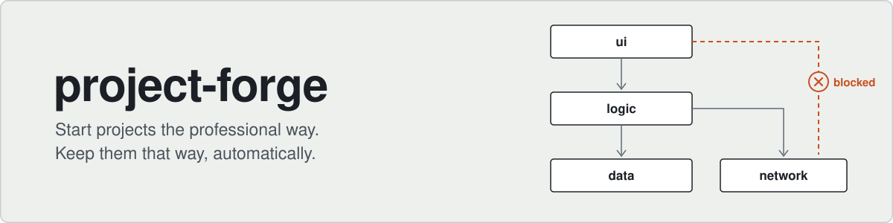
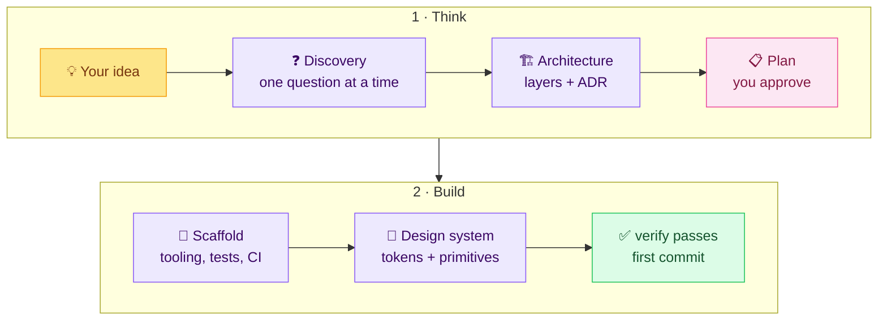
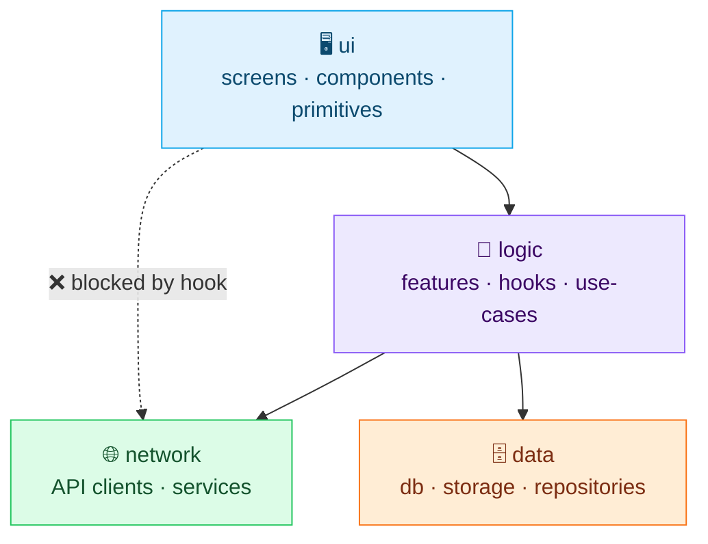

<p align="center">
  
</p>

<p align="center">
  <a href="https://github.com/vikrampratapsinghraghav/project-forge/actions/workflows/test.yml"></a>
  
  
  
  
  
  
</p>

<h3 align="center">One plugin to <b>start</b> a project right, and keep it <b>clean, secure and fast</b> for its whole life.</h3>

<p align="center">
  <a href="#-quick-start">Quick start</a> ·
  <a href="#-what-you-get">What you get</a> ·
  <a href="#-how-it-works">How it works</a> ·
  <a href="#-commands">Commands</a> ·
  <a href="#-guardrails">Guardrails</a> ·
  <a href="#-faq">FAQ</a>
</p>

---

## 🤔 Why project-forge?

Most projects start clean and slowly rot. Shortcuts pile up, UI calls the database directly, colours get hard-coded, tests get skipped, and one day a key ends up in git.

**project-forge stops that from day one.** It sets up the project properly, writes down the rules, and then **enforces** them automatically on every edit and every commit, so you never have to remind anyone (or any AI).

<table>
  <tr>
    <td align="center" width="25%">🏗️<br><b>Clean architecture</b><br><sub>UI → logic → network/data layers, enforced on every edit</sub></td>
    <td align="center" width="25%">🎨<br><b>Real design system</b><br><sub>Tokens, primitives, DESIGN.md. No random colours.</sub></td>
    <td align="center" width="25%">🛡️<br><b>Security by default</b><br><sub>Secret &amp; danger guards, headers, RLS, audits</sub></td>
    <td align="center" width="25%">⚡<br><b>Fast by default</b><br><sub>Bundle budget + dead-code check in every build</sub></td>
  </tr>
</table>

---

## 🚀 Quick start

Run inside Claude Code (Mac, Linux or cloud):

```text
/plugin marketplace add vikrampratapsinghraghav/project-forge
/plugin install project-forge@project-forge
```

Then open an empty folder and run:

```text
/new-project
```

> [!TIP]
> Installing project-forge also installs its companion plugins automatically: **superpowers**, **feature-dev**, **frontend-design**, **pr-review-toolkit**, **code-simplifier**, **claude-md-management** and **security-guidance**. If one is missing, run `claude update`, then `/reload-plugins`.

---

## 🎁 What you get

Every project created with `/new-project` comes with:

| | Area | Included |
|:-:|---|---|
| 🏗️ | **Architecture** | Layered folders, typed env module, one HTTP client with timeouts, error boundaries, ADR for the stack decision |
| 🎨 | **Design** | Visual direction, design tokens (light + dark), accessible UI primitives, `DESIGN.md` |
| 🛡️ | **Security** | Security headers + CSP, zod validation at boundaries, authorization rules (Supabase RLS), rate limiting, Dependabot, `SECURITY.md` |
| ⚡ | **Performance** | Bundle-size budget, `knip` dead-code check, pagination / caching / lazy-loading rules |
| ✅ | **Quality** | TypeScript strict, ESLint, Prettier, tests per layer, one `verify` command, CI on every push |
| 📘 | **Living docs** | `CLAUDE.md`, `ARCHITECTURE.md`, `DESIGN.md`, `SECURITY.md`, PR template |
| ☁️ | **Works everywhere** | `.claude/settings.json` so every session (local or cloud) loads the same rules |

**Default stacks:** ▲ **Next.js** for web · 📱 **Expo / React Native** for mobile · or "find the best fit" for your requirements.

---

## 🧭 How it works



### Layers stay clean



---

## 🧰 Commands

| Command | What it does |
|---|---|
| 🆕 **`/new-project`** | Interviews you, designs the architecture, scaffolds the app, writes all docs, sets up tests, CI and guardrails. Use **adopt mode** for an existing repo. |
| 🎨 **`/design-system`** | Picks a visual direction (uses design galleries and Figma if connected), creates tokens, `DESIGN.md` and UI primitives |
| 🔍 **`/forge-review`** | Runs `verify` plus the architecture, design, security and performance reviewers on your changes |
| 🛡️ **`/security-audit`** | Release-readiness audit of the whole repo, ending in a **READY / NOT READY** verdict |
| 📝 **`/update-rules`** | Saves a new decision in the right doc and keeps `CLAUDE.md` short |

### 🤖 Reviewer agents

| Agent | Looks for |
|---|---|
| 🏗️ `architecture-guardian` | Layer breaks, duplicated code, missing tests, swallowed errors, docs drift |
| 🎨 `design-guardian` | Raw colours/sizes, hand-rolled components, accessibility, missing states |
| 🛡️ `security-guardian` | Secrets, broken access control (IDOR), injection, unsafe config, risky dependencies |
| ⚡ `performance-guardian` | Heavy bundles, N+1 queries, unbounded lists, missing caching, re-render waste |

---

## 🚦 Guardrails

These run automatically. Nobody has to remember them.

| When | Guard | Effect |
|---|---|---|
| ✍️ Before any file edit | 🔑 **Secret guard** | Blocks API keys, tokens and private keys from being written into code |
| 💻 Before any shell command | 🧨 **Danger guard** | Blocks `rm -rf /`, force-push to `main`, `curl \| sh`, `--no-verify`, `chmod 777`, printing `.env` |
| 💾 After every edit | 🧱 **Layer + token check** | Flags UI importing network/data, and raw hex / rgb / px outside the tokens file |
| 📦 Before every commit | 🚧 **Commit gate** | Blocks secrets and un-ignored `.env`, then runs `verify` (lint · typecheck · tests · dead code · size) |
| 🔁 Every push / PR | ☁️ **CI** | Same `verify` + dependency audit |

> [!NOTE]
> The secret and danger guards protect **every** project. All other checks only run inside folders that contain `.forge/config.json`, so your other repos are untouched.

<details>
<summary><b>⚙️ Configure per project: <code>.forge/config.json</code></b></summary>

```json
{
  "verifyCommand": "pnpm verify",
  "aliases": { "@/": "src/" },
  "layers": {
    "ui": ["src/app", "src/components", "src/ui"],
    "logic": ["src/features", "src/domain", "src/hooks"],
    "network": ["src/services", "src/api"],
    "data": ["src/data", "src/db"]
  },
  "forbidden": {
    "ui": ["network", "data"],
    "logic": ["ui"],
    "network": ["ui", "logic"],
    "data": ["ui", "logic", "network"]
  },
  "design": {
    "tokensFiles": ["src/ui/theme/tokens.ts"],
    "checkDirs": ["src/app", "src/components", "src/ui"]
  }
}
```

Presets for web and mobile live in [`plugins/project-forge/templates/presets/`](plugins/project-forge/templates/presets/). Add `forge-ignore` on a line to deliberately skip a check.
</details>

<details>
<summary><b>☁️ Use it in cloud sessions and for every collaborator</b></summary>

`/new-project` writes this into each project's `.claude/settings.json`:

```json
{
  "extraKnownMarketplaces": {
    "project-forge": {
      "source": { "source": "github", "repo": "vikrampratapsinghraghav/project-forge" },
      "autoUpdate": true
    }
  },
  "enabledPlugins": { "project-forge@project-forge": true }
}
```

Anyone who opens the repo (after trusting the folder) gets the same plugin, rules and guardrails.
</details>

---

## 🗂️ Repository layout

```text
project-forge/
├─ .claude-plugin/marketplace.json     ← this repo is a plugin marketplace
├─ plugins/project-forge/
│  ├─ skills/      new-project · design-system · forge-review · security-audit · update-rules
│  ├─ agents/      architecture · design · security · performance guardians
│  ├─ hooks/       secret guard · danger guard · post-edit checks · commit gate (plain Node)
│  ├─ lib/         layer, design-token, secret and danger rules (pure, tested)
│  └─ templates/   CLAUDE.md · ARCHITECTURE.md · DESIGN.md · SECURITY.md · tokens · CI · presets
├─ tests/          node:test suite, zero dependencies
└─ scripts/        manifest validator
```

---

## ❓ FAQ

<details>
<summary><b>Does it slow down my editing?</b></summary>

No. The per-edit checks are static and run in milliseconds. Only the commit gate runs your full `verify`, which is the point.
</details>

<details>
<summary><b>Can I use it on an existing project?</b></summary>

Yes. Run `/new-project` and choose **adopt**. It reads your code, maps your real folders to layers, writes the docs and config, and lists the refactors needed, without changing code unless you approve.
</details>

<details>
<summary><b>Is it a replacement for a security review?</b></summary>

No. The guards stop common, costly mistakes and `/security-audit` is a strong automated review. For apps that handle money or sensitive personal data, still get a professional penetration test.
</details>

<details>
<summary><b>What do I need installed?</b></summary>

Claude Code, Git, and Node.js 18+. The hooks have zero npm dependencies.
</details>

---

## 🛠️ Develop

```bash
npm run verify    # validate manifests + run the test suite
```

CI runs the suite on **macOS and Linux** with Node 20 and 22.

## 📄 License

MIT © Vikram Pratap Singh

<p align="center"><sub>Built for people who want to ship fast <b>and</b> sleep well. ⭐ Star the repo if it helps you.</sub></p>
