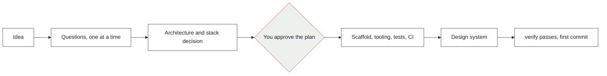

<p align="center">
  
</p>

<p align="center">
  <a href="https://github.com/vikrampratapsinghraghav/project-forge/actions/workflows/test.yml"></a>
  
  
  
</p>

**project-forge** is a Claude Code plugin that sets up a new project properly and then keeps it that way. It writes the architecture, design system and rules on day one, and then enforces them on every edit and every commit, so nobody has to remember them.

```text
/plugin marketplace add vikrampratapsinghraghav/project-forge
/plugin install project-forge@project-forge
```

Then, in an empty folder, run `/new-project`.

## The problem it solves

Projects start clean and drift. UI code starts calling the database, colours get hard-coded, tests get skipped "just this once", and eventually an API key lands in git. Written guidelines don't stop this, because nothing checks them.

project-forge turns the guidelines into checks that run automatically.

## What a new project gets

| Area | Set up by `/new-project` |
|---|---|
| Architecture | Layered folders (ui → logic → network / data), typed env module, one HTTP client with timeouts, error boundaries, a decision record for the stack |
| Design | A visual direction made for your product, design tokens for light and dark, accessible UI primitives, `DESIGN.md` |
| Security | Security headers and CSP, server-side validation, authorization rules (including Supabase RLS), rate limiting, Dependabot, `SECURITY.md` |
| Performance | A bundle-size budget and a dead-code check inside `verify`, plus rules for pagination, caching and lazy loading |
| Quality | Strict TypeScript, linting, tests for each layer, one `verify` command, CI on every push |
| Docs | `CLAUDE.md`, `ARCHITECTURE.md`, `DESIGN.md`, `SECURITY.md` and a PR checklist |

Default stacks are Next.js for web and Expo for mobile. You can also ask it to find the best fit for your requirements.

## How setup works



Nothing is generated until you approve the plan.

## What runs automatically

| When | Check | Result |
|---|---|---|
| Before a file is written | Secret guard | Blocks API keys, tokens and private keys in code |
| Before a shell command runs | Danger guard | Blocks `rm -rf /`, force-push to `main`, `curl \| sh`, `--no-verify`, `chmod 777` and printing `.env` |
| After every edit | Layer and design check | Flags UI importing network or data, raw colours and sizes outside the tokens file, and decorative gradients or glass blur |
| Before Claude ends a turn | Turn gate | Runs `verify` when files changed since the last pass, so Claude fixes failures before handing back (`"verifyOnStop": false` turns it off) |
| Before every commit | Commit gate | Blocks secrets and un-ignored `.env` files, then runs `verify` (lint, typecheck, tests, dead code, size budget) |
| On every push | CI | Runs `verify` and a dependency audit |

The secret and danger guards protect every project. All other checks only run in folders that contain `.forge/config.json`, so your other repositories are not affected.

## Design that doesn't look generated

Generated interfaces tend to look the same: purple gradients, glass panels, identical rounded cards, one highlighted word in the headline. `/design-system` works differently:

1. It grounds the direction in your product's subject and audience.
2. It drafts a small plan (palette, type, layout, principles), then reviews that plan against a list of common defaults and revises anything generic.
3. It picks one bold element and keeps everything else quiet.
4. It records the choices, and the defaults it avoided, in `DESIGN.md`.

After that, the hooks flag gradients and blur unless the approved direction calls for them, and the design reviewer checks new screens against `DESIGN.md`.

## Commands

| Command | Use it to |
|---|---|
| `/new-project` | Start a project, or adopt an existing repository without rewriting it |
| `/design-system` | Create or extend the visual direction, tokens and UI primitives |
| `/forge-review` | Review changes before a commit or PR, using `verify` plus four reviewers |
| `/security-audit` | Check the whole repository before a release and get a ready or not-ready verdict |
| `/update-rules` | Record a new decision in the right document and keep `CLAUDE.md` short |

The four reviewers are agents that read code and report findings without editing anything:

- **architecture-guardian**: layer breaks, duplicated code, missing tests, swallowed errors
- **design-guardian**: raw values, hand-rolled components, accessibility, generated-looking UI, unclear copy
- **security-guardian**: secrets, broken access control, injection, unsafe configuration, risky dependencies
- **performance-guardian**: heavy bundles, N+1 queries, unbounded lists, missing caching

Installing project-forge also installs the official plugins it builds on: superpowers, feature-dev, frontend-design, pr-review-toolkit, code-simplifier, claude-md-management and security-guidance. If any are missing, run `claude update`, then `/reload-plugins`.

<details>
<summary><b>Project configuration (<code>.forge/config.json</code>)</b></summary>

```json
{
  "verifyCommand": "pnpm verify",
  "aliases": { "@/": "src/" },
  "layers": {
    "ui": ["src/app", "src/components", "src/ui"],
    "logic": ["src/features", "src/domain", "src/hooks"],
    "network": ["src/services", "src/api"],
    "data": ["src/data", "src/db"]
  },
  "forbidden": {
    "ui": ["network", "data"],
    "logic": ["ui"],
    "network": ["ui", "logic"],
    "data": ["ui", "logic", "network"]
  },
  "design": {
    "tokensFiles": ["src/ui/theme/tokens.ts"],
    "checkDirs": ["src/app", "src/components", "src/ui"],
    "allow": []
  }
}
```

Presets for web and mobile are in [`plugins/project-forge/templates/presets/`](plugins/project-forge/templates/presets/). To skip a check on one line on purpose, add `forge-ignore` to that line.
</details>

<details>
<summary><b>Cloud sessions and collaborators</b></summary>

`/new-project` adds this to the project's `.claude/settings.json`, so anyone who opens the repository (after trusting the folder) gets the same plugin and rules, locally or in the cloud:

```json
{
  "extraKnownMarketplaces": {
    "project-forge": {
      "source": { "source": "github", "repo": "vikrampratapsinghraghav/project-forge" },
      "autoUpdate": true
    }
  },
  "enabledPlugins": { "project-forge@project-forge": true }
}
```
</details>

<details>
<summary><b>Repository layout</b></summary>

```text
.claude-plugin/marketplace.json    this repository is a plugin marketplace
plugins/project-forge/
  skills/      new-project, design-system, forge-review, security-audit, update-rules
  agents/      architecture, design, security and performance reviewers
  hooks/       secret guard, danger guard, post-edit checks, commit gate (plain Node)
  lib/         the rules behind the hooks, pure and tested
  templates/   CLAUDE.md, ARCHITECTURE.md, DESIGN.md, SECURITY.md, tokens, CI, presets
tests/         node:test suite with no dependencies
scripts/       manifest validator
```
</details>

## Questions

**Does it slow down editing?** No. The per-edit checks are static and take milliseconds. Only the commit gate runs your full `verify`.

**Can I use it on an existing project?** Yes. Run `/new-project` and choose adopt. It maps your real folders to layers, writes the docs and config, and lists the refactors it recommends. It doesn't change code unless you approve.

**Does it replace a security review?** No. The guards catch common, costly mistakes, and `/security-audit` is a thorough automated review. Apps that handle money or sensitive personal data still need a professional penetration test.

**What do I need?** Claude Code, Git and Node.js 18 or newer.

## Development

```bash
npm run verify   # validates the manifests and runs the tests
```

CI runs the tests on macOS and Linux with Node 20 and 22.

## License

MIT, Vikram Pratap Singh
